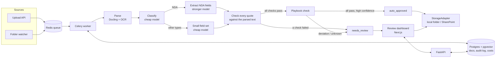
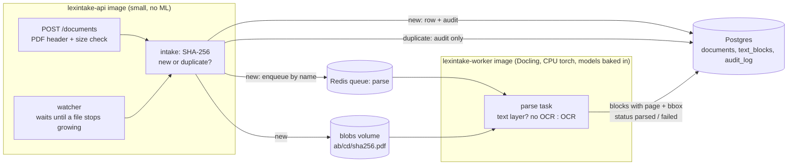
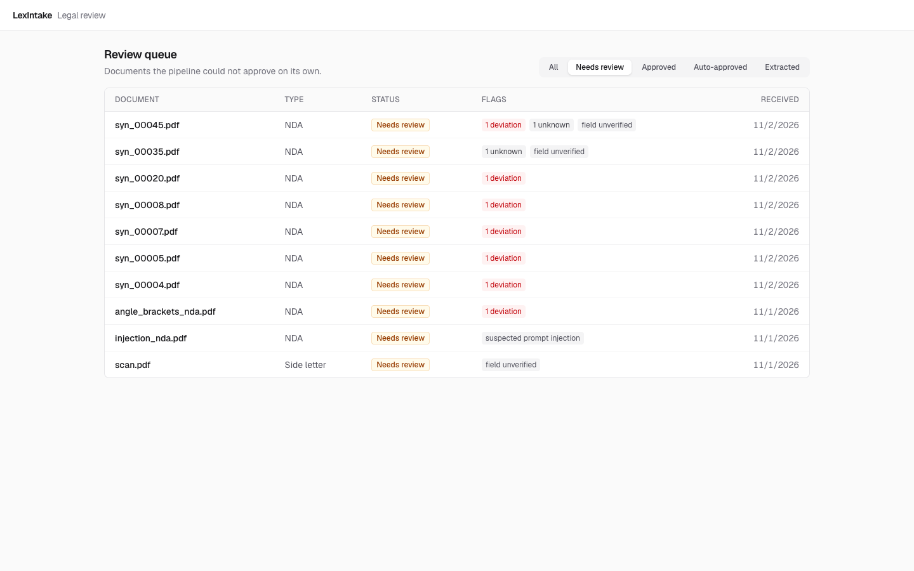
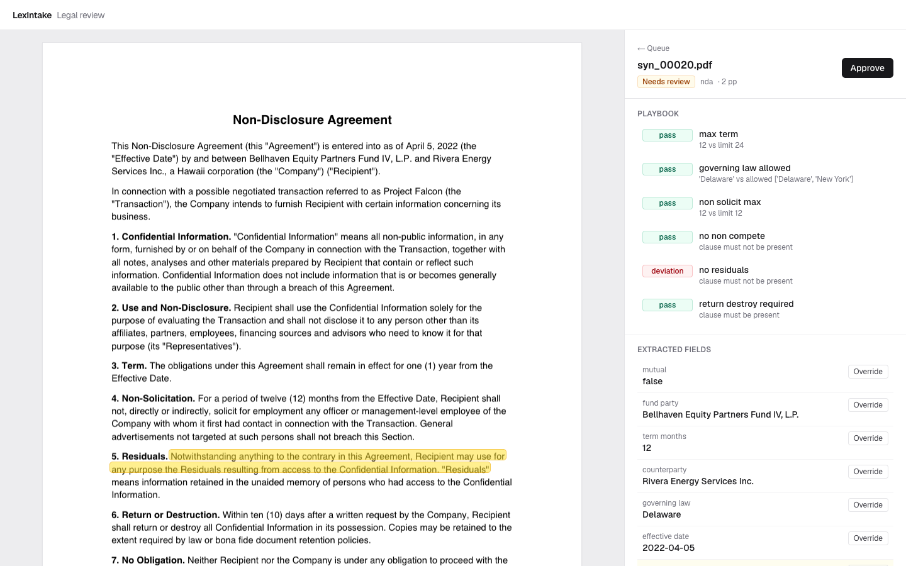

# LexIntake

Automated intake and triage for legal documents at a private equity firm. LexIntake reads incoming
NDAs, side letters, investor notices and legal notices. It works out what each one is, pulls out
the key terms with page-level evidence, and checks them against the legal team's playbook, so
lawyers only review the documents that get flagged.

> Independent portfolio project, not affiliated with any firm. It uses only public and synthetic
> data.

**Status:** Phases 0–2 (scaffold, data, ingestion & parsing) are done. Phase 3 (classification &
extraction) is built and tested with a fake extractor; its first real-model run is pending. The
pipeline is built phase by phase.
See [PROMPTS.md](PROMPTS.md).

## The problem

A mid-market PE legal team receives thousands of documents a year by email, scanned mail and
SharePoint. Today someone reads every one, decides what it is, checks it against the firm's
standards, files it and tracks it by hand. Most documents are routine. LexIntake does the first
pass and sends only the unusual ones to a lawyer.

## Architecture



Phase 0 builds the boxes that hold everything up: FastAPI, the Celery worker, Redis, Postgres
with pgvector, and the Next.js app, all running together in Docker Compose. Phase 2 adds intake
and parsing (below). Phase 3 adds classification, extraction and the citation checks
([Classification & extraction](#classification--extraction-phase-3)). Phase 4 checks NDAs against
the playbook ([Playbook check](#playbook-check-phase-4)). The minimal review page is Phase 6 ([Review page](#review-page-phase-6-minimal)); filing (Phase 5) is skipped for now.

### Ingestion and parsing (Phase 2)



Status flow: `received → parsing → parsed`, or `failed` with the error saved. Every change writes
a row in `audit_log` in the same transaction. A duplicate upload writes an audit row too
(`detail.event = "duplicate_received"`) but never starts a second parse.

## Tools and libraries, and why

| Tool | Why |
| --- | --- |
| **Python 3.12 + uv** | uv installs packages much faster than pip and writes a lockfile (`uv.lock`), so every machine and CI run gets exactly the same versions. |
| **FastAPI** | Typed request and response models (via Pydantic), automatic OpenAPI docs at `/docs`, and async support for upload endpoints. |
| **Pydantic v2 / pydantic-settings** | Validates data at the edges: settings from env vars now, and later the LLM's JSON output, so bad output is rejected instead of trusted. |
| **Celery + Redis** | Parsing and LLM calls are slow, so they run as background jobs. Redis is the queue. Celery gives retries and acknowledges a job only after it finishes, so a crashed worker doesn't lose it. |
| **Postgres 16 + pgvector** | One database for document metadata, the audit log, cost tracking and (later) embeddings. That means fewer moving parts than a separate vector database. |
| **Next.js + TypeScript + Tailwind** | Server components can call the API over the internal Docker network. TypeScript catches mistakes before runtime, and Tailwind keeps styling quick. |
| **Docker Compose** | One command starts every service (database, queue, migrations, API, watcher, worker, frontend) with the same setup on any machine. |
| **ruff, pytest, ESLint** | Fast linting and formatting for Python, tests for the backend, and linting for the frontend. |
| **GitHub Actions** | Runs lint, tests, the lockfile check and a full `docker compose up` smoke test on every push. |
| **PyYAML** | The NDA playbook is a YAML file, so lawyers could read and edit the rules without touching code. `safe_load` never runs code from the file. |
| **Faker** | Generates realistic fake names, companies and addresses for synthetic documents. You can seed it, so the same seed gives the same names. |
| **ReportLab** | Builds the synthetic PDFs from text. Its `invariant` mode removes timestamps and random IDs, so the same input gives a byte-identical PDF. |
| **pypdfium2** | Python bindings for PDFium, Chrome's PDF engine. It rasterises pages to make scanned copies, and the tests use it to read the text layer. |
| **Pillow + NumPy** | Pillow rotates and blurs the page images and saves them as an image-only PDF. NumPy adds seeded noise and dust specks. |
| **SQLAlchemy 2 + psycopg 3** | Typed table models and plain synchronous sessions (both FastAPI's sync endpoints and Celery are sync, which keeps things simple). psycopg 3 is the current Postgres driver. |
| **Alembic** | Database migrations: every schema change is a versioned script, so any database can be brought to the current schema with `alembic upgrade head`. A test fails if the models and migrations drift apart. |
| **watchfiles** | Watches the inbox folder (Rust-based, already installed with uvicorn). It can fall back to polling, which Docker Desktop bind mounts need. |
| **Docling** (`docling-slim`) | Layout-aware PDF parsing: it finds paragraphs, headings, list items and tables, with a bounding box and page for each one, in reading order. The `-slim` package lets the worker install only PDF + layout + OCR, not Office/audio support. |
| **RapidOCR on onnxruntime** | Docling's default OCR engine: CPU-friendly, small models, and it doesn't need a second copy of torch (EasyOCR would). It reports a confidence score per page. |
| **PyTorch, CPU-only build** | Docling's layout model runs on torch. The default Linux wheel bundles ~5 GB of NVIDIA CUDA libraries we never use, so the worker installs torch from PyTorch's CPU index instead. |
| **rapidfuzz** | Fuzzy string matching for OCR output, where small character mistakes make exact matching useless. Phase 3 uses it in production code to check quotes from OCR'd pages. |
| **Anthropic Python SDK** | Calls Claude for classification and extraction. Structured outputs make the reply follow a JSON schema built from our Pydantic models, prompt caching makes the fixed instructions cheap after the first call, and the SDK retries rate limits and server errors with backoff. Model names come only from `.env`. |

**Dependency groups** (in `backend/pyproject.toml`) decide what goes where:

| Group | Contents | Installed in |
| --- | --- | --- |
| main | FastAPI, SQLAlchemy, Alembic, Celery, watchfiles, anthropic, rapidfuzz, ... | every image, and locally |
| `parse` | Docling, CPU-only torch, RapidOCR | the worker image only (and locally with `--group parse`) |
| `test` | pytest, httpx | locally, CI, and the worker-test image |
| `dev` | `test` + ruff + the data-script packages (Faker, ReportLab, ...) | locally and CI |

A plain `uv sync` never downloads torch, so the fast tests and the backend CI job stay quick.

Coming in later phases: Playwright (end-to-end tests for the dashboard).

## File structure

```
lexintake/
├── CLAUDE.md                     # Project brief and working rules for Claude Code
├── PROMPTS.md                    # Phase-by-phase build prompts (Phases 0–9)
├── README.md                     # This file
├── LICENSE                       # MIT license
├── Makefile                      # Shortcuts: make dev / test / test-slow / smoke / lint / ...
├── docker-compose.yml            # db, redis, migrate, api, watcher, worker, extractor, frontend (+ worker-test)
├── requirements.txt              # Pinned backend deps exported from uv.lock (CI checks it is in sync)
├── .env.example                  # Every env var the app reads, placeholder values only
├── .gitignore                    # Keeps .env, data/, .venv/, node_modules/ etc. out of git
├── .github/workflows/ci.yml      # CI on every push: backend (+Postgres), frontend, compose end-to-end
├── .github/workflows/slow-tests.yml # Real-Docling tests: parsing-related changes, nightly, on demand
├── docs/phase4-dry-run.md        # Playbook dry run with the FAKE extractor (plumbing, not accuracy)
├── docs/phase3-dry-run.md        # Pipeline dry run with the FAKE extractor (checks + routing, not accuracy)
├── inbox/                        # Gitignored. Drop PDFs here; the watcher ingests them
├── db/init/01_extensions.sql     # Enables pgvector the first time Postgres starts
├── playbook/
│   └── nda_playbook.yaml         # The legal team's standard NDA terms (max term, allowed law, ...)
├── scripts/
│   ├── __init__.py               # Makes scripts/ importable (tests, python -m)
│   ├── download_data.py          # Downloads ContractNLI (+ CUAD), checks SHA-256, safe to re-run
│   ├── compose_smoke.py          # Upload → wait for parsed → re-upload as duplicate → run the playbook checker in the containers
│   ├── seed_demo.py              # Demo documents for the review screens (fake extractor, no API)
│   ├── playbook_ground_truth.py  # Checker output vs the manifest's deviations (make playbook-truth)
│   ├── playbook_dry_run_report.py # Summarises the fake-extractor dry run into docs/phase4-dry-run.md
│   ├── parse_quality.py          # Evidence hit rates on the synthetic set + deskew experiment
│   ├── ingest_smoke.py           # Sends ContractNLI's raw PDFs through the running stack
│   ├── generate_synthetic.py     # CLI: plans the document mix, renders PDFs, writes the manifest
│   ├── make_special_fixtures.py  # Builds the prompt-injection NDA and the angle-bracket NDA fixtures
│   ├── extract_preview.py        # 20-doc preview vs the manifest (real API, or --fake / --dry-run)
│   └── synth/
│       ├── __init__.py           # Package docstring: how the three modules fit together
│       ├── fields.py             # Samples ground-truth fields per document type
│       ├── templates.py          # Turns fields into document text and records evidence per field
│       └── render.py             # Digital PDFs (ReportLab) and scanned copies (pypdfium2 + Pillow)
├── data/                         # Gitignored. Created by `make data` / `make synthetic`
│   ├── contractnli/              # train/dev/test.json, LICENSE, raw/ original NDAs
│   ├── cuad/                     # Optional (make data-cuad)
│   ├── downloads/                # Verified zip archives, kept so re-runs needn't download again
│   ├── synthetic/                # docs/syn_00001.pdf ... and manifest.json
│   └── reports/                  # parse_quality, ingest_smoke, extract_preview (.md + .json)
├── backend/
│   ├── pyproject.toml            # Backend dependencies + ruff and pytest settings
│   ├── uv.lock                   # Exact pinned versions of every dependency
│   ├── .python-version           # Tells uv to use Python 3.12
│   ├── Dockerfile                # Targets: api (small), worker (Docling + models), worker-test
│   ├── .dockerignore             # Keeps .venv, caches and .env out of the build context
│   ├── alembic.ini               # Alembic settings (the DB URL comes from DATABASE_URL)
│   ├── alembic/
│   │   ├── env.py                # Runs migrations against DATABASE_URL (or a test connection)
│   │   ├── script.py.mako        # Template for new migration files
│   │   ├── versions/0001_ingestion_tables.py # documents, text_blocks, audit_log
│   │   ├── versions/0002_extraction.py # new statuses, doc_type columns, extractions, llm_calls
│   │   ├── versions/0003_playbook.py # auto_approved status, extractions.playbook_results
│   │   └── versions/0004_approved.py # approved status (a person approved it)
│   ├── app/
│   │   ├── __init__.py           # Marks app/ as a package
│   │   ├── config.py             # Settings read from env vars (DB, Redis, blobs, inbox, limits, ...)
│   │   ├── main.py               # FastAPI app, CORS setup, GET /health, document routes
│   │   ├── db.py                 # SQLAlchemy engine, session_scope(), FastAPI session dependency
│   │   ├── models.py             # Tables: Document, TextBlock, AuditLog, Extraction, LlmCall; enums
│   │   ├── status.py             # transition(): the only place a status changes (+ audit row)
│   │   ├── intake.py             # Shared intake: PDF check, hash, dedupe, store, audit, enqueue
│   │   ├── queue.py              # Sends the parse / extract tasks to Celery by name
│   │   ├── watcher.py            # Inbox watcher with the file-stability check
│   │   ├── cli.py                # app.cli requeue (failed step again) and extract (--limit, --max-spend)
│   │   ├── playbook.py           # Loads the playbook YAML; check_playbook gives pass / deviation / unknown with evidence
│   │   ├── worker.py             # Celery app, queue routing, `ping` task
│   │   ├── routes/documents.py   # POST /documents (upload), GET /documents/{id} (+ type, review reasons)
│   │   ├── storage/blobs.py      # BlobStore interface + LocalBlobStore (content-addressed)
│   │   ├── parsing/
│   │   │   ├── __init__.py       # get_parser(): builds the Docling parser once per process
│   │   │   ├── base.py           # Parser interface, Block, ParseResult, ParseError
│   │   │   ├── docling_parser.py # Per-page text-layer check, Docling passes, blocks with bboxes
│   │   │   └── download_models.py # Downloads the models at image build time
│   │   ├── extraction/
│   │   │   ├── schemas.py        # Pydantic models: doc types, per-subtype fields (= manifest), cited fields
│   │   │   ├── doctext.py        # Parsed text per page, the shared normalize(), escaping for the prompt
│   │   │   ├── prompts.py        # Fixed (cacheable) system prompts; the document fenced and escaped
│   │   │   ├── base.py           # Extractor interface, CallPlan (model, prompts, schema), LlmResult
│   │   │   ├── anthropic_extractor.py # The real Extractor: structured output, caching, error mapping
│   │   │   ├── pricing.py        # $/MTok per model, cost of a call, worst case, SpendGuard
│   │   │   ├── verify.py         # Quote checks (exact / fuzzy OCR), value in quote, keyword scans
│   │   │   ├── route.py          # The rules that send a document to needs_review, with reasons
│   │   │   └── run.py            # One document: lock, classify, extract, verify, route, save, audit
│   │   └── tasks/
│   │       ├── parse.py          # The Celery parse task: lock, claim, parse, save, audit
│   │       └── extract.py        # The Celery extract task: daily spend cap, retries with backoff
│   └── tests/
│       ├── __init__.py           # Marks tests/ as a package
│       ├── conftest.py           # Fresh lexintake_test database per run, migrated; per-test cleanup
│       ├── fakes.py              # FakeParser, RecordingQueue, FakeExtractor (no Docling, no API)
│       ├── docs.py               # Puts parsed test documents (from manifest entries) into the DB
│       ├── test_migrations.py    # Tables exist; downgrade/upgrade works; models match migrations
│       ├── test_status.py        # Allowed transitions write audit rows; others are refused
│       ├── test_blobs.py         # Content-addressed paths, no-op re-put, atomic write
│       ├── test_upload.py        # 201 new / 200 duplicate / 415 / 413 / concurrent duplicates
│       ├── test_watcher.py       # Growing files wait; processed/rejected moves; retry on errors
│       ├── test_parse_task.py    # Idempotency, redelivery, failures, poison guard, locks
│       ├── test_cli.py           # requeue picks the right step; extract: --limit, spend cap, costs
│       ├── test_schemas.py       # Field models match the manifest key for key; cited-field rules
│       ├── test_prompts.py       # System prompts are fixed; documents can't break out of their tags
│       ├── test_verify.py        # Exact/fuzzy quote matching, value in quote, absent-clause scan
│       ├── test_anthropic_extractor.py # Request shape, usage/cache tokens, errors, prices (stub client)
│       ├── test_extract_run.py   # The extract step end to end with the fake: every route and failure
│       ├── test_extract_task.py  # Celery task: daily spend cap, retries then failed
│       ├── test_injection.py     # Prompt-injection NDA can't get approved; AI mentions aren't flagged
│       ├── test_extract_preview.py # The preview report's arithmetic on fake results
│       ├── test_download_models.py # A model download that is really an error page fails the build
│       ├── test_image_split.py   # The api image's dependencies contain no torch/Docling
│       ├── fixtures/             # Synthetic PDFs (+ injection and angle-bracket NDAs) and manifests
│       ├── integration/          # Slow tests with real Docling (pytest -m slow)
│       ├── test_health.py        # /health returns ok; CORS allows the frontend, blocks others
│       ├── test_config.py        # Env vars parse correctly (CORS list, two model names)
│       ├── test_worker.py        # Celery ping task runs and is registered
│       ├── test_playbook.py      # Each playbook rule catches its deviation; null handling
│       ├── test_download_data.py # Checksum check, skip on re-run, zip-slip guard (no network)
│       └── test_synthetic_data.py # Reproducibility, manifest vs files, text layers, evidence
└── frontend/
    ├── package.json              # Frontend deps and scripts (dev, build, lint, typecheck)
    ├── package-lock.json         # Exact pinned npm versions
    ├── next.config.ts            # Standalone output for Docker, Tailwind loader, Cache Components on
    ├── tsconfig.json             # TypeScript settings
    ├── eslint.config.mjs         # ESLint rules (Next.js preset)
    ├── AGENTS.md                 # Notes Next.js writes for coding agents (re-added by `next dev`)
    ├── Dockerfile                # Multi-stage build, runs the standalone server
    ├── .dockerignore             # Keeps node_modules and .next out of the build context
    ├── .gitignore                # Next.js-specific ignores
    └── src/
        ├── app/layout.tsx        # Root HTML layout and fonts
        ├── app/page.tsx          # Status page: server-side and browser-side API health checks
        ├── app/globals.css       # Tailwind import and theme
        ├── app/favicon.ico       # Browser tab icon
        ├── components/StatusRow.tsx      # One row of the health panel
        ├── components/BrowserHealth.tsx  # Client component that calls the API from the browser
        └── lib/api.ts            # The two API URLs (server-side vs browser-side)
```

## Setup

You need [uv](https://docs.astral.sh/uv/), Node 22 and Docker Desktop.

```bash
git clone https://github.com/<your-username>/lexintake.git && cd lexintake
cp .env.example .env          # then fill in ANTHROPIC_API_KEY, ANTHROPIC_MODEL_CLASSIFY, ANTHROPIC_MODEL_EXTRACT (Phase 3)
make install                  # uv creates backend/.venv with Python 3.12; npm installs the frontend
```

uv downloads Python 3.12 itself if you don't have it, so you don't need conda or pyenv.

## How to run

```bash
make dev
```

- Frontend: http://localhost:3000. Both health rows should say **Healthy**.
- API: http://localhost:8000/health, with interactive docs at http://localhost:8000/docs

If ports 3000/8000 are already in use, set `FRONTEND_PORT` / `API_PORT` in `.env` and update
`NEXT_PUBLIC_API_URL` and `CORS_ORIGINS` to match.

Send it a document, either through the API or by dropping a file in the inbox:

```bash
curl -F "file=@backend/tests/fixtures/syn_00001.pdf" http://localhost:8000/documents
curl http://localhost:8000/documents/<id from the response>     # status, page_count, block_count
cp backend/tests/fixtures/syn_00002.pdf inbox/                    # the watcher picks it up
make smoke                                                         # upload, wait for parsed, re-upload
```

The first upload returns `201` with `"status": "received"`. A few seconds later `GET` shows
`"parsed"`. Uploading the same bytes again returns `200` with `"duplicate": true` and the same id.
Files dropped in `inbox/` move to `inbox/.processed/` (or `inbox/.rejected/` with a `.reason.txt`).

Run the tests and linters:

```bash
make test        # fast tests (~5 s); starts the Postgres container if it isn't running
make test-slow   # slow tests with real Docling, inside the worker image (~20 s once built)
make lint
```

To run the slow tests without Docker: `cd backend && uv sync --group parse && uv run pytest -m slow`.

Check parsing quality and robustness (Phase 2 reports, written to `data/reports/`):

```bash
make parse-quality   # needs make synthetic; ~8 min on an M4 Pro (uses the GPU via MPS)
make ingest-smoke    # needs make data and the stack running; 23 ContractNLI PDFs end to end
```

Classify and extract (Phase 3). **`make extract` and `make extract-preview` call the Anthropic API
and cost money**; set `ANTHROPIC_API_KEY`, `ANTHROPIC_MODEL_CLASSIFY` and
`ANTHROPIC_MODEL_EXTRACT` in `.env` first. Uploads are never sent to the API by themselves
(`EXTRACT_ON_PARSE=false`).

```bash
make extract LIMIT=20 MAX_SPEND=0.50   # classify + extract up to 20 parsed docs, stop before $0.50
make extract-preview MAX_SPEND=1.00    # 20 fixed synthetic docs + report vs the manifest

# Free, no API calls:
PYTHONPATH=backend uv run --project backend python -m scripts.extract_preview --dry-run  # worst-case cost
PYTHONPATH=backend uv run --project backend python -m scripts.extract_preview --fake     # fake extractor
```

`make extract` prints a table per step and model: calls, input/output tokens, cache writes and
reads, and cost. `GET /documents/<id>` shows the type and, for `needs_review`, the reasons.

Get the data (see [Data](#data) for what each one is):

```bash
make data         # download + verify ContractNLI into data/contractnli (65 MB)
make data-cuad    # optional: also CUAD into data/cuad (106 MB)
make synthetic    # 500 synthetic PDFs + manifest into data/synthetic (about 10 s, 44 MB)
```

Both commands are safe to re-run. `make data` skips datasets that are already there, and `make
synthetic` replaces the previous output. For other options, call the generator directly:

```bash
PYTHONPATH=backend uv run --project backend python -m scripts.generate_synthetic --seed 7 --n 1000
```

Other commands: `make down` (stop the stack), `make requeue` (re-queue documents stuck in
`received`, e.g. if Redis was down at upload time; `STATUS=received,failed make requeue` also
retries failed ones), `make requirements` (regenerate `requirements.txt` after changing
dependencies), `make eval` (evaluation harness, Phase 7).

## Data

Nothing in `data/` is committed. The scripts rebuild it, so anyone gets the same data.

### Public datasets

| Dataset | What it is | Source | License |
| --- | --- | --- | --- |
| **ContractNLI** (primary eval set) | 607 real NDAs. Each is labelled against 17 hypotheses ("Receiving party may retain some information", ...) as Entailment / Contradiction / NotMentioned, with evidence spans. | [stanfordnlp.github.io/contract-nli](https://stanfordnlp.github.io/contract-nli/), file `resources/contract-nli.zip` | [CC BY 4.0](https://creativecommons.org/licenses/by/4.0/) (Hitachi America, Ltd.) |
| **CUAD v1** (optional) | 510 commercial contracts with 41 clause types labelled by lawyers. | [Zenodo record 4595826](https://zenodo.org/records/4595826), file `CUAD_v1.zip` | [CC BY 4.0](https://creativecommons.org/licenses/by/4.0/) (The Atticus Project) |

CC BY 4.0 allows use and redistribution as long as you credit the source, which the citations
below do. `download_data.py` pins each archive's SHA-256:

- ContractNLI: `e03fc77b…6287b`
- CUAD: `88b694d9…8d18e` (the file also matches Zenodo's published MD5
  `c38f490a984420b8a62600db401fafd5`)

If the upstream file ever changes, the script stops instead of using it.

```bibtex
@inproceedings{koreeda-manning-2021-contractnli-dataset,
    title = "{C}ontract{NLI}: A Dataset for Document-level Natural Language Inference for Contracts",
    author = "Koreeda, Yuta and Manning, Christopher",
    booktitle = "Findings of the Association for Computational Linguistics: EMNLP 2021",
    year = "2021",
    publisher = "Association for Computational Linguistics",
    url = "https://aclanthology.org/2021.findings-emnlp.164",
    pages = "1907--1919",
}

@article{hendrycks2021cuad,
    title = {CUAD: An Expert-Annotated NLP Dataset for Legal Contract Review},
    author = {Dan Hendrycks and Collin Burns and Anya Chen and Spencer Ball},
    journal = {NeurIPS},
    year = {2021}
}
```

### Synthetic mailroom (`data/synthetic/`)

`scripts/generate_synthetic.py` builds documents from templates. It makes no LLM calls, so it costs
nothing, and the same `--seed` always gives the same documents. The default run (seed 42, 500 docs)
contains:

| Type | Count | Variants |
| --- | --- | --- |
| NDA | 201 | one-way or mutual; term, governing law and optional clauses vary |
| Side letter | 76 | any mix of fee discount, MFN, co-invest and advisory seat |
| Investor notice | 98 | capital call, distribution, annual meeting |
| Legal notice / claim | 50 | demand letter, notice of breach, subpoena |
| Other | 75 | invoice, newsletter, board minutes, marketing flyer |

- **Scanned copies (100, about 20% of every type).** Each page is rasterised at 150 DPI with
  pypdfium2, turned grey, rotated 0.5–2.5°, blurred slightly, given noise and dust specks, and saved
  as an image-only PDF. These files have **no text layer**, so Phase 2 has to OCR them.
- **NDAs vs the playbook.** Half the NDAs meet every rule in
  [`playbook/nda_playbook.yaml`](playbook/nda_playbook.yaml). The other half break one or two rules,
  and every rule gets broken somewhere. The generator picks terms by reading the playbook, and each
  NDA's `deviations` is computed by running the playbook, so the two always agree.
- **Tricky cases.**
  - 5 exact duplicates: byte-identical copies under a new name.
  - 3 near-duplicates: the same NDA with exactly one clause changed.
  - 3 NDAs with unusual titles, such as "Evaluation Material Letter Agreement".
- **Neutral file names** (`syn_00001.pdf`), so the file name gives away nothing about the type.
- All names are fictional and come from Faker plus made-up fund families. Any resemblance to a
  real firm is coincidental.

### The manifest (`data/synthetic/manifest.json`)

This is the ground truth that Phase 7 grades against. It has one entry per file (abridged example):

```json
{
  "doc_id": "syn_00001", "file": "docs/syn_00001.pdf", "sha256": "e8ae42…",
  "doc_type": "nda", "subtype": null, "title": "Mutual Confidentiality Agreement",
  "scanned": true, "scan_rotation_deg": 2.45, "pages": 2,
  "fields": {
    "counterparty": "Pearson Aerospace LLC", "fund_party": "Ostrander Hill Capital Fund IV, L.P.",
    "effective_date": "2025-01-16", "mutual": true, "term_months": 6,
    "governing_law": "Cayman Islands", "non_solicit_months": 9, "non_compete_months": null,
    "residuals_clause": null, "return_destroy_days": 30
  },
  "evidence": {
    "governing_law": "This Agreement shall be governed by and construed in accordance with the laws of the Cayman Islands, without regard to its conflict of laws principles.",
    "...": "..."
  },
  "deviations": ["governing_law_allowed"],
  "tricky": null, "duplicate_of": null, "near_duplicate_of": null, "changed_field": null
}
```

**What `null` means:**

- **In `fields`, `null` means the clause is absent from the document.** `"non_compete_months":
  null` means the NDA has no non-compete. It never means "unknown", and it isn't written as `0` or
  `false`.
- A clause with a number stores that number when present (`non_solicit_months: 9`,
  `return_destroy_days: 30`). A clause with no number (`residuals_clause`, and the side-letter
  clauses `mfn`, `co_investment` and `advisory_committee_seat`) is `true` when present and `null`
  when absent. Clauses never use `false`.
- Core fields are never null. For NDAs those are `counterparty`, `fund_party`, `effective_date`,
  `mutual`, `term_months` and `governing_law`. `mutual` is a real true/false value, because it
  describes the structure of the NDA rather than a clause.
- A field that doesn't apply to a document type is left out of `fields`, not set to null. For
  example, an invoice has no `governing_law` key.
- At the top level of an entry, `deviations` is `null` for non-NDAs, because the playbook doesn't
  apply to them. `duplicate_of`, `near_duplicate_of` and `changed_field` are `null` unless the
  document is that kind of tricky case.

**Evidence** is the exact text in the document that states each field. Every non-null field has
one, and absent clauses have none. For digital PDFs the tests check that every evidence string
appears verbatim in the extracted text, after collapsing whitespace, because a wrapped line comes
out with a newline where the space was. **Scanned PDFs need fuzzy matching in Phase 7.** Their text
only exists after OCR, and OCR makes small mistakes ("l" for "1", dropped punctuation, merged
words). So exact substring matching would mark correct answers as wrong. Phase 7 should use a
normalised edit-distance or token-overlap threshold for scanned documents instead.

**Reproducibility.** The same seed with the same locked dependencies on the same OS gives
byte-identical PDFs and manifest. That's why the manifest can store each file's SHA-256. On a
different OS the fields, text and evidence stay identical, but scanned-PDF bytes, and so their
hashes, can differ slightly, because image rendering and JPEG compression vary by platform.

## Ingestion & parsing (Phase 2)

### What happens to a file

1. **Intake** (`app/intake.py`, shared by the upload endpoint and the watcher). The file must start
   with `%PDF-` (within the first 1 KB, as the PDF spec allows) and be under `MAX_UPLOAD_MB`
   (default 50), or it gets `415` / `413`. Then its SHA-256 is computed.
2. **Dedupe.** `INSERT ... ON CONFLICT (sha256) DO NOTHING` either creates the row or finds that
   these exact bytes were seen before. Two simultaneous uploads of the same file can't both win.
   A duplicate gets an audit row and returns the existing document; nothing is stored or parsed
   again.
3. **Store.** The original goes into the blob store under its own hash (`ab/cd/abcd….pdf`), written
   to a temp file and renamed, so a crash never leaves half a file. Phase 5's `StorageAdapter` will
   file *copies* out of here; the blob store stays the untouchable original.
4. **Queue.** Only after the row is committed is the parse task queued (by name, so the API never
   imports Docling). If Redis is down, the document stays `received` and `make requeue` picks it up.
5. **Parse** (`app/tasks/parse.py`, worker image). pypdfium2 checks each page for a text layer
   (≥ 20 visible characters). Pages with text go through Docling without OCR; pages without get
   full-page RapidOCR. Each text block is saved with its page, bounding box (PDF points, top-left
   origin, ready for highlighting in Phase 6), Docling label, reading order, `source`
   (`text_layer` / `ocr`) and, for OCR, a confidence.

**Safe to retry.** A `parsed` document is never parsed again. A Postgres advisory lock stops two
workers from parsing the same document at once. Blocks are replaced (delete + insert) in the same
transaction that sets `parsed`, so a re-run can't duplicate them. Each attempt is counted *before*
parsing starts, so a PDF that crashes the worker outright is marked `failed` after
`PARSE_MAX_ATTEMPTS` (3) instead of being redelivered forever.

### Two images: why and how

Docling needs PyTorch, its layout model and the OCR models. Putting all that in the API would make
a 400 MB web server into a multi-GB one that takes longer to build, pull and start. So
`backend/Dockerfile` has build targets that share their base layers:

| Image | Target | Used by | Contains | Size* |
| --- | --- | --- | --- | --- |
| `lexintake-api` | `api` | api, watcher, migrate | Python + main dependencies + app | ~420–440 MB |
| `lexintake-worker` | `worker` | Celery worker | + Docling, CPU-only torch, RapidOCR, models | ~2.8 GB (arm64) / 4.3 GB (amd64) |
| `lexintake-worker-test` | `worker-test` | slow tests only | + pytest and the tests | about the same as the worker |

\*Uncompressed. arm64 is measured on the Mac (sum of the layers); amd64 is what `docker image ls`
reports in CI. On arm64, ~1.7 GB of the worker is Python packages (torch alone is 690 MB) and
730 MB is models. The uv download cache is a BuildKit cache mount, so it never ends up in an image
(it had added 1.3 GB before that fix).

- **CPU-only torch.** `[tool.uv.sources]` points torch and torchvision at
  `download.pytorch.org/whl/cpu` on Linux, which drops ~5 GB of CUDA libraries. macOS keeps the
  normal wheel (which supports MPS).
- **Models at build time.** The model download is its own layer, *before* the app code is copied,
  so changing code never re-downloads 730 MB. At runtime `HF_HUB_OFFLINE=1` turns a missing model
  into an error instead of a surprise download, and the worker loads the models when each process
  starts, not on the first document.
- **Guards.** A fast test checks the api image's dependency list has no torch/Docling/onnxruntime.
  CI also tries `import docling` and `import torch` inside the running api container and fails if
  either works.

### Fast and slow tests in CI

| Workflow / job | When | What | Time |
| --- | --- | --- | --- |
| `ci.yml` → backend | every push and PR | ruff, fast pytest (fake parser) with a Postgres service; never installs torch | ~45 s |
| `ci.yml` → compose | every push and PR | builds api + worker images with GitHub Actions layer cache, boots the stack, uploads a real PDF, waits for the real worker to parse it, re-uploads it as a duplicate | ~3 min with cache, ~7 min cold |
| `slow-tests.yml` | PRs/pushes touching parsing, tasks, intake, models, migrations, Dockerfile, deps, fixtures or integration tests; nightly; manual button | real Docling on digital, scanned, duplicate and corrupt fixtures, inside the worker-test image | ~3.5 min with cache, ~6 min cold |

Times are from the first CI runs of this phase. Most of the "with cache" time is restoring the
multi-GB worker layers; the tests themselves take ~15 s.

The slow tests are marked `@pytest.mark.slow`, and `pytest` skips them by default
(`addopts = -m "not slow"`). They run inside the same image that ships, so CPU torch, the baked
models and the system libraries are all tested together. The worker-test image reuses the worker's
cached layers, so building it is cheap. A docs or frontend change never triggers them. The nightly
run catches drift that no path filter would see, such as a base-image update.

### Results

Numbers from `make parse-quality` (500 synthetic docs, M4 Pro, about 8 minutes including the
deskew experiment) and `make ingest-smoke` (ContractNLI originals through the running Docker stack).
Full reports are written to `data/reports/`.

**Synthetic set: are the ground-truth evidence strings in the parsed text?**

| | Docs | Evidence strings | Found | Wrong source* | Seconds / page |
| --- | --- | --- | --- | --- | --- |
| Digital (exact match) | 400 | 2,412 | **100%** | 0 | 0.08 |
| Scanned (fuzzy, score ≥ 90) | 100 | 600 | **91.5%** (≥ 80: 93.5%, mean score 97.3) | 0 | 0.99 |

\*A digital doc with any OCR block, or a scanned doc with any text-layer block. Zero means the
per-page text-layer check routed every page correctly.

The scanned misses aren't scattered typos. In 31 of the 100 scans, RapidOCR dropped or garbled a
whole line or two (one line of a clean scan came out as "Trn rn n i n tt n t ts"). Mean OCR
confidence is still 0.98, so confidence alone won't catch it. That matters for Phase 3:
extraction from OCR'd pages needs lower trust, and missing fields there should go to
`needs_review`.

**Deskew experiment (100 scans, rotated 0.5–2.5°):**

| Variant | Mean score | ≥ 80 | ≥ 90 | ≥ 90 by rotation (<1° / 1–2° / >2°) |
| --- | --- | --- | --- | --- |
| As-is (what the worker does) | 97.28 | 93.5% | 91.5% | 90.4% / 93.4% / 87.5% |
| Oracle (rotated back by the true angle) | 98.21 | 96.0% | 93.5% | 92.1% / 94.3% / 92.7% |
| Estimated angle (projection profile) | 97.50 | 94.2% | 91.0% | 92.1% / 92.6% / 86.0% |

The estimate is very accurate (mean error 0.04°, max 0.11°), but deskewing barely helps. Even a
perfect deskew adds only 2 points at ≥ 90, mostly on the >2° scans, and the realistic version
gains nothing (−0.5). So deskew is **not** added to the worker; the line drops above are a bigger
target (e.g. try RapidOCR's medium model or Tesseract).

**ContractNLI originals (real-world PDFs) through the full stack:**

- 23 random PDFs (seed 0): 20 uploaded through the API and 3 dropped in the inbox. **23/23 parsed,
  no crashes**, 2–15 pages each, 1–11 s per document.
- A scan of all 375 raw PDFs found 367 with a text layer on every page and 8 that mix text pages
  with image-only pages (none are fully scanned). **All 8 parsed**, and their image-only pages came
  back as `ocr` blocks (confidence 0.96–0.98). One "image-only" page was an empty table with just a
  page number, so it correctly gave no blocks.

## Classification & extraction (Phase 3)

> **Real-model accuracy and cost are still pending.** Everything below is built and tested with a
> fake extractor, but the first real run (20 documents, `make extract-preview MAX_SPEND=1.00`)
> hasn't been done yet. [docs/phase3-dry-run.md](docs/phase3-dry-run.md) shows the whole pipeline
> on those 20 documents with the fake extractor: it proves the checks and routing work, not how
> accurate a real model is.

### What happens to a parsed document

```
parsed ──► extracting ──┬─► extracted      every check passed (NDAs: the playbook decides next, below)
                        ├─► needs_review   at least one check failed; the reasons are saved
                        └─► failed         the API kept failing, or a setting is missing
```

1. **Classify** with the cheap model (`ANTHROPIC_MODEL_CLASSIFY`, e.g. Haiku): type, subtype,
   confidence and a quote that shows the type (usually the title). If the type is in doubt, the
   document goes to review right here, before paying for step 2.
2. **Extract.** NDAs get the full 10 fields from the stronger model (`ANTHROPIC_MODEL_EXTRACT`,
   e.g. Sonnet). Side letters, notices and the rest get their small field set (2–8 fields) from the
   cheap model. The fields are exactly the manifest's, per subtype, so every type can be scored.
3. **Check** every answer in code (below), then **route**. Every status change is in the audit log.

Each field comes back as `{value, page, quote, confidence}`. `null` means the clause is absent,
as in the manifest. The model is allowed to say "not found" instead of guessing.

### The checks (nothing the model says is trusted until it passes)

| Check | What it catches |
| --- | --- |
| The quote exists in the parsed text: exactly on text-layer pages, fuzzily (≥ 90) on OCR pages | Made-up quotes |
| The value appears inside its own quote ("five (5) years" supports 60 months; dates in any common format) | A real quote next to an invented value |
| Quotes found on another page | Page corrected and flagged, not rejected |
| Output fits the Pydantic schema (page exists, a value always has a quote, confidence 0–1) | Broken or cut-off JSON: retried once, then review |
| Confidence ≥ 0.8 (classification and fields), ≥ 0.9 plus match ≥ 95 for fields read by OCR | Answers the model itself doubts; OCR can drop a line and still report 0.98 |
| **NDA guard:** ≥ 2 NDA signals in the text but not classified as an NDA | An NDA slipping past the NDA checks by being misclassified |
| **Absent-clause scan:** the model says "no non-compete" but the text says "compete" | Missed clauses (no quote exists to check an absence) |
| **Injection check:** text addressed to the model ("ignore previous instructions", "note to the AI", fake `</document>` tags) | A planted value whose quote *is* real |
| Type `other`, a partial parse, or a refusal | Out of scope or unreliable input |

The model's confidence can only push a document towards review, never past a failed check.

### Documents are untrusted input

The instructions live in the system prompt. The document goes in the user message inside
`<document>` tags, with `<` and `>` in its text replaced by `‹` `›`, so it can't close the tag or
fake a new one; quotes are turned back before checking. The most important defence is structural:
the model's output has **no** status or approval field, so code alone decides the route, and every
value must be quoted from the document. A test NDA with three planted attacks
(`backend/tests/fixtures/injection_nda.pdf`) proves that a model that obeys them still can't get
the document approved.

### Cost control

- Two models, both from `.env`: the cheap one sees every document, the strong one only NDAs.
- **Prompt caching:** the fixed instructions are a cached prefix, so every call after the first
  reads them at a tenth of the price or less. `llm_calls` saves cache reads and writes for every call.
- **Every call is recorded** in `llm_calls` (tokens, cache tokens, cost, model as reported by the
  API), including failed attempts. Cost per document per model is one `GROUP BY`.
- **Spend cap:** before *every* call, the run checks spent-so-far + that call's worst case (all
  input uncached + the full `max_tokens` of output) against `MAX_SPEND_USD`. Because it plans for
  the worst case, a run can't go over the cap. The document it stops at goes back to `parsed`.
- `--limit`, `EXTRACT_ON_PARSE=false` by default, and prices live in one file
  (`app/extraction/pricing.py`). A model without a price refuses to run.
- Retries: the SDK retries rate limits and server errors with backoff. The extract worker then
  retries up to 3 more times with longer waits before marking the document `failed`.

### Running the real preview (later)

```bash
# .env: ANTHROPIC_API_KEY, ANTHROPIC_MODEL_CLASSIFY, ANTHROPIC_MODEL_EXTRACT
make dev
PYTHONPATH=backend uv run --project backend python -m scripts.extract_preview --dry-run  # free
make extract-preview MAX_SPEND=1.00                                                         # paid
```

The report (`data/reports/extract_preview.md`) shows classification accuracy, NDA recall,
per-field exact match, span verification, review reasons, absent-clause flags, cache use and cost
per document per model, all split digital vs scanned. The dry run estimates the worst case at
$0.80 for the 20 documents; real calls use far fewer output tokens than the maximum.

## Playbook check (Phase 4)

After extraction, every NDA is compared with the legal team's standard positions in
[`playbook/nda_playbook.yaml`](playbook/nda_playbook.yaml). Lawyers can edit that file without
touching code. The rules:

| Rule id | Field | Passes when |
|---|---|---|
| `max_term` | `term_months` | 24 months or less |
| `governing_law_allowed` | `governing_law` | Delaware or New York |
| `non_solicit_max` | `non_solicit_months` | no non-solicit, or 12 months or less |
| `no_non_compete` | `non_compete_months` | there is no non-compete |
| `no_residuals` | `residuals_clause` | there is no residuals clause |
| `return_destroy_required` | `return_destroy_days` | the NDA has a return/destroy obligation |

Each rule returns one of three answers, with the evidence (page + quote) behind it:

- **pass**: the value was verified and meets the rule.
- **deviation**: the value was verified and breaks the rule.
- **unknown**: we can't tell. The field was missing, the quote wasn't found in the text, the value
  isn't in its quote, or the model said "absent" while the text mentions the clause.

**Why unknown never auto-approves.** A rule we couldn't check is not a rule that was met. If
"unknown" counted as a pass, a bad scan or a made-up quote could slip a 10-year term past the
legal team. So the only way to be auto-approved is for every rule to be a verified pass.

```
extracting ──► extracted ──┬─► auto_approved   NDA: every extraction check AND every rule passed
                           └─► needs_review    NDA: a deviation or unknown (rule ids + reasons saved)
```

Non-NDAs keep their Phase 3 routing (`extracted` or `needs_review`); the playbook doesn't apply.
Both hops are in the audit log, and `extractions.playbook_results` keeps the full per-rule answer.
The checker is `check_playbook` in `backend/app/playbook.py`, the same module the data generator
uses, so labels and checks can't drift apart. The playbook is mounted into the containers at
`/playbook` (read-only), and the compose smoke test runs the checker inside the worker and api
containers.

**Checked against ground truth.** Feeding every synthetic NDA's manifest fields to the checker
gives exactly the manifest's deviations (n=40 in CI; `make playbook-truth` runs the full 500: 201
NDAs, 0 mismatches). The fake-extractor dry run is in
[`docs/phase4-dry-run.md`](docs/phase4-dry-run.md): plumbing only, not model accuracy.

## Review page (Phase 6, minimal)

Two screens at <http://localhost:3000> (see `.env` for your port):



**Queue.** Every document with its type, status and flags (deviation / unknown counts and review
reasons), filtered by status. It opens on *Needs review*.



**Document.** The PDF on the left, with the quote behind the selected field highlighted. On the
right: the playbook results (pass / deviation / unknown, each with its reason), the extracted
fields with their quotes, why the document is in the queue, and the audit trail. Click a rule or a
field to see its evidence on the PDF.

- **Approve** moves a `needs_review` (or `extracted`) document to `approved`, a separate status
  from `auto_approved`, so a person's decision is always visible. The audit row says who.
- **Override** replaces one field's value. The old value stays on the field and in the audit
  log (with an optional reason), and the playbook is checked again with the new value, which now
  counts as verified by a person. An override does not approve the document.
- **How highlights work.** Digital pages: pdf.js searches the page's own text for the quote and
  boxes the text it finds. Scanned pages have no text layer, so the boxes come from the OCR text
  blocks stored at parse time (`text_blocks` bounding boxes, in PDF points).
- **Endpoints** (`backend/app/routes/review.py`): `GET /review/documents?status=`,
  `GET /review/documents/{id}`, `GET /review/documents/{id}/file`, `POST .../approve`,
  `POST .../fields/{name}/override`.
- **Limits.** There is no login yet, so every action is recorded as the actor `reviewer`.
  Approved documents are not filed anywhere (Phase 5, storage, is skipped for now).

**Demo data.** `make seed-demo` uploads a few PDFs (the committed fixtures, plus some synthetic
NDAs if `data/synthetic/` exists), lets the worker parse them, and "extracts" them with the **fake
extractor**, which answers from the manifest. The screens show real parsing and real playbook
checks, but the extraction is not a model's work, and no API is called. Running it again resets
those documents.

**Test.** `cd frontend && npm run e2e` runs the Playwright test against the seeded stack: open
the queue, open a `needs_review` NDA, see the `no residuals` deviation, approve it. CI runs it in
the Docker Compose job. (`E2E_CHROME=1 E2E_BASE_URL=http://localhost:3105` uses your installed
Chrome and a different port.)

## Evaluation results

Coming in Phase 7.

## How it was built

1. **Phase 0, scaffold.** I set up a uv-managed FastAPI backend with typed settings, CORS and a
   health endpoint, plus a Celery worker on Redis. I added a Next.js frontend that checks the API
   from both the server and the browser, a Docker Compose stack with healthchecks and pgvector,
   a Makefile, and CI that lints, tests, checks the lockfile and boots the whole stack.
2. **Phase 1, data.** I found the official sources for ContractNLI and CUAD and checked their
   licenses (both CC BY 4.0). Then I wrote a standard-library download script that verifies a pinned
   SHA-256, extracts safely and skips finished datasets. Next I wrote the NDA playbook as YAML, with
   a small evaluator in the backend, so "standard terms" are defined in one place. On top of that I
   built a seeded template-based generator: it samples fields (NDA terms chosen against the
   playbook), writes text that records the evidence for each field, renders reproducible PDFs, and
   makes scanned copies with no text layer. It adds duplicates, near-duplicates and unusual titles,
   and writes a manifest. Tests check that the manifest matches the files and that every evidence
   string really appears in the PDF.
3. **Phase 2, ingestion & parsing.** I added SQLAlchemy and Alembic and wrote the first migration
   (documents, text_blocks, audit_log), with one `transition()` function as the only way to change
   a status, so every change is audited. Then I built the content-addressed blob store, the shared
   intake path (PDF check, hash, race-safe dedupe, store, queue), the upload endpoint and the inbox
   watcher with its file-stability check. Next came the parse task behind a `Parser` interface,
   tested with a fake parser for idempotency, crashes, retries and locks, and then the real Docling
   parser with a per-page text-layer check. I split the Docker image into a small api image and a
   worker image with CPU-only torch and models baked in. Running the slow tests inside that image
   showed the layout model merging whole pages into one block. The cause was that Docling's default
   renderer had no fonts in the slim image; switching to the pdfium backend fixed it, and a test now
   guards against it. Last, I set up CI (Postgres service, cached image builds, an end-to-end upload,
   a separate slow-test workflow) and wrote the quality and ContractNLI crash-test scripts.
4. **Phase 3, classification & extraction.** I started with Pydantic models that match the
   manifest key for key, and a test that validates all 500 manifest entries against them. Then a
   migration for the new statuses, `extractions` and `llm_calls`. Next came the prompt builder
   (fixed, cacheable system prompts; the document fenced and escaped) and the citation checks:
   exact or fuzzy quote matching, the value-in-quote check, the absent-clause scan and the NDA
   guard. Then the `Extractor` interface with the real Anthropic implementation and a fake for
   tests, the pricing table and spend guard, the routing rules and the idempotent extract step,
   tested end to end with the fake for every route and failure. Then the CLI, the Celery task
   and the `extractor` service. Building a prompt-injection test NDA showed that a planted value
   gets a *real* quote, so I added the injection check. Rebuilding the worker image showed the OCR
   model host returning error pages saved as model files, so the build now checks the models.
   Last, the preview script and a fake-extractor dry run on 20 documents. The real run is pending.

## Key concepts

- **Lockfiles and reproducible installs.** `pyproject.toml` says what you want (`fastapi>=0.162`).
  `uv.lock` records exactly what got installed. `uv sync --locked` fails if the two drift apart.
  `requirements.txt` is generated from the lockfile, and CI checks it is in sync.
- **Background jobs with Celery.** The API puts work on a Redis queue and returns immediately, and
  separate worker processes do the slow parts. `task_acks_late` means a job is only marked done
  after it finishes, so a crash leads to a retry instead of a lost document.
- **Docker networking: two URLs for one API.** Inside Docker, containers reach each other by
  service name (`http://api:8000`). The browser runs on your Mac, so it needs `localhost:8000`.
  That's why the frontend has `API_URL_INTERNAL` (server) and `NEXT_PUBLIC_API_URL` (browser).
- **`NEXT_PUBLIC_*` is baked in at build time.** Next.js copies these values into the JS bundle
  during `npm run build`, so changing them needs a rebuild, not just a restart. That's why the
  compose file passes it as a build arg.
- **CORS.** Browsers block a page on `localhost:3000` from reading responses from `localhost:8000`
  unless the API says that origin is allowed. Server-to-server calls don't go through CORS at all.
- **Healthchecks and `depends_on: service_healthy`.** "The container started" is not the same as
  "Postgres accepts connections". Healthchecks make the api and worker wait until db and redis are
  actually ready.
- **Settings from the environment (12-factor).** Code never hardcodes secrets or the model name.
  They come from env vars, with `.env` for local dev and `.env.example` documenting them.
- **Checksums.** A SHA-256 hash is a fingerprint of a file's bytes. If even one byte changes, the
  hash changes. Pinning the expected hash means a corrupted, truncated or swapped download is
  caught before it's used. The same idea powers deduplication in Phase 2: identical files have
  identical hashes.
- **Idempotent scripts.** Running a script twice should leave things as if it ran once. The
  download script writes a `.complete` marker only after everything has finished, and it extracts
  into a staging folder that it renames at the end. So an interrupted run is simply redone, and a
  finished one is skipped.
- **Zip slip.** A malicious zip can contain a path like `../../.bashrc` that writes outside the
  target folder. The extractor resolves each path and refuses any that escape.
- **Seeded randomness and reproducibility.** Computers make "random" numbers from a seed, so the
  same seed gives the same sequence. Everything random in the generator comes from seeded sources.
  Dates come from a fixed range rather than from "today", and the PDFs have no timestamps. As a
  result, the same seed gives byte-identical output, which the tests check.
- **Text layer vs scanned PDF.** A digital PDF stores the characters, so you can select and copy
  the text. A scanned PDF only stores a picture of the page, so getting text out of it needs OCR,
  which is slower and makes mistakes. A real mailroom has both, so the pipeline has to handle both.
- **Ground truth and evidence.** You can only measure accuracy against known correct answers. The
  manifest is built from the same field values that produce the document text, so it is correct by
  construction. The recorded evidence also lets Phase 7 check *where* the model found an answer,
  not just whether the value is right.
- **Single source of truth.** The playbook YAML defines "standard terms" once. The generator uses
  it to label the data, and Phase 4's checker uses it to flag real documents, so the labels and
  the checker can't drift apart.
- **Database migrations (Alembic).** The schema lives in versioned scripts, not in "whatever
  the tables look like on my laptop". `alembic upgrade head` brings any database up to date, and a
  one-shot `migrate` container runs it before the api and worker start. `alembic check` (run as a
  test) fails if someone edits the models without writing a migration.
- **Content-addressed storage.** Files are stored under their own SHA-256. The same bytes always
  land at the same path, so storing a duplicate is a no-op and a stored file can't be silently
  changed.
- **Race-safe dedupe with `ON CONFLICT`.** "Check if it exists, then insert" has a gap where two
  requests can both see "no" and both insert. Letting the database's unique constraint decide
  (`INSERT ... ON CONFLICT DO NOTHING RETURNING id`) closes that gap. A test fires four uploads at
  once and checks only one document is created.
- **Idempotent, retryable tasks.** A queue can deliver the same task twice (for example after a
  worker crash, because of `acks_late`). The parse task is written so running it twice gives the
  same result as once: it skips parsed documents, takes an advisory lock, and replaces blocks in
  one transaction.
- **Poison messages.** A file that crashes the worker never reaches the `except` block, so the
  task counts each attempt before it starts. After 3 attempts the document is marked `failed`
  instead of crashing workers forever.
- **Commit, then enqueue.** The task is queued only after the database row is committed. Otherwise
  a fast worker could look for a row that doesn't exist yet.
- **Splitting images by dependency weight.** The API and the worker run the same code but need very
  different libraries. Build targets in one Dockerfile share the common layers, uv dependency
  groups decide which packages each target gets, and Docker's layer cache means the big layers
  (torch, models) are only rebuilt when the lockfile changes.
- **Fast vs slow tests.** Most logic (dedupe, statuses, retries, the watcher) is tested in
  milliseconds with a fake parser. A handful of slow tests check the real parser, and CI runs them
  only when something they cover changes, plus nightly.
- **"Works on my Mac" bugs.** The parser gave 17 blocks on macOS and 3 in Docker for the same PDF.
  The model, weights and math were identical; the page *image* wasn't. Docling's default renderer
  drew text with system fonts, and the slim image has none. The lesson: test inside the image that
  ships, and compare inputs step by step until they differ.
- **Text layer vs OCR, per page.** OCR is slow and makes mistakes, so it should only run where
  there is no text to read. Checking each page separately handles PDFs that mix typed pages with
  scanned signature pages.
- **Waiting for a file to finish arriving.** A file being copied into a folder exists before it's
  complete. The watcher waits until its size and modified time stay the same for two checks and
  it's at least 2 seconds old.
- **Fuzzy matching.** OCR turns "VII, L.P." into "VII,L.P.", so exact matching would call that a
  miss. `partial_ratio` scores how well the best-matching part of the text lines up with the
  evidence (0–100).
- **Deskewing with a projection profile.** If you add up the ink in each row of a page image, level
  text lines give sharp peaks and gaps; tilted lines smear them out. Trying small rotations and
  keeping the one with the sharpest profile (highest variance) estimates the tilt.
- **Explicit null semantics.** "Clause absent", "unknown" and "not applicable" are different
  things. The manifest uses `null` only for "absent" and leaves out fields that don't apply.
  Phase 3's "the model isn't sure" will be a separate confidence score, so grading never has to
  guess what a value means.
- **Check the citation, not the model's word.** Every extracted value has to point at the exact
  text it came from, and code checks that the text is really there and really contains the value.
  The model's confidence is a hint that can send a document to a person; it can never approve one.
- **Prompt injection.** A document is data from a stranger, and it may contain text written to
  steer the model. Keep instructions and document apart (system prompt vs fenced user message),
  give the model no output field that grants approval, and treat text addressed to the model as a
  reason for human review.
- **Structured outputs + validation.** The API can force JSON that matches a schema, but a reply
  can still be cut off or break rules a JSON schema can't express (a page that doesn't exist). So
  Pydantic validates again, and an invalid reply is retried once, then sent to review.
- **Prompt caching is a prefix match.** The API reuses a cached prompt only if every byte before
  the cache marker is identical, so the system prompts are constants with no dates or ids in them.
- **Plan for the worst case when capping spend.** You don't know a call's cost until it returns,
  so the guard compares the cap with the most the next call could cost.
- **Model cascades.** A cheap model handles the easy, high-volume step (what is this?) and gates
  the expensive one, so the strong model only reads the documents that need it.

## Known issues

- **httpx deprecation warning in tests.** `pytest` prints a `StarletteDeprecationWarning` from
  FastAPI's `TestClient` saying `httpx` is deprecated there. It's harmless and all tests pass.
  The fix is left for later, until the suggested replacement package has been checked.
- **Port clashes.** If something else on your machine already uses 3000/8000 (or 5432/6379),
  `docker compose up` fails with "port is already allocated". Set the `*_PORT` variables in
  `.env` (see the "How to run" section).
- **ContractNLI is text, not PDFs (next step for Phase 7).** The labels and evidence spans in
  `train/dev/test.json` are character offsets into each NDA's plain `text`. The zip also ships
  originals in `raw/` (375 PDFs plus 113 .htm and 119 .txt files), but their layout doesn't match those
  offsets. So Phase 7 will need to either render the JSON text to PDF, reusing
  `scripts/synth/render.py` so the offsets still line up, or let the pipeline accept text input
  directly. This isn't built yet.
- **A writer that pauses mid-file can fool the watcher.** A file is picked up after it hasn't
  changed for ~2 seconds. If something writes half a file, pauses longer than that, then finishes,
  the watcher takes the half file (which then fails parsing with a clear error). Real copies,
  scanners and sync clients write continuously, or write to a temp name and rename, which the
  watcher handles (temp names like `*.part` and `*.tmp` are ignored).
- **Mixed documents are parsed twice.** A PDF with both text pages and image-only pages runs
  through Docling once without OCR and once with it, keeping each page from the right pass. Mixed
  documents are rare (8 of 375 in ContractNLI), but an 11-page one with a single scanned page took
  40 s instead of ~6 s. Running the OCR pass on just the scanned pages (Docling's `page_range`)
  would fix it.
- **OCR occasionally drops whole lines** (see Results). Confidence scores don't reveal it.
- **The deskew result only covers mild tilt.** The synthetic scans are rotated at most 2.5°;
  real mailroom scans can be tilted much more, where deskewing may well pay off.
- **The worker image is big (~2.8 GB on arm64, 4.3 GB on amd64).** Most of it is torch
  (CPU-only) and 730 MB of models.
  It's built once and cached; only the small app layer changes between commits.
- **Intermediate commit.** In this phase's history, the upload commit imports a constant from
  `app/worker.py` that only arrives two commits later. The branch tip is fine; bisecting across
  those two commits would hit an import error.
- **Phase 3: the real 20-document preview hasn't been run.** Everything is tested with a fake
  extractor (see [docs/phase3-dry-run.md](docs/phase3-dry-run.md)), so real-model accuracy and
  cost are unknown. Next step: `make extract-preview MAX_SPEND=1.00` (worst case $0.80).
- **Phase 3: replay fixtures from real responses still to be recorded.** After the real run,
  `scripts.extract_preview --report-only --record` saves about six real responses plus their
  parsed text to `backend/tests/fixtures/llm/`, so tests can replay real model output without
  calling the API. Until then, the tests use only the fake extractor and a stub client.
- **Phase 3 option: a free local-model Extractor.** A local model (for example one served by
  Ollama) could sit behind the same `Extractor` interface (`call(plan, doc) -> LlmResult`) for
  development runs that cost nothing. Not built; its accuracy would need the same preview report.
- **Phase 3: the daily spend cap is per worker check.** With several extract workers running at
  once, each checks the day's total before its own call, so together they can go a little over
  the cap. `make extract` (one process) can't.
- **Phase 3: the absent-clause and NDA-signal keyword lists are tuned on synthetic text.** They
  fire on none of the synthetic non-NDAs, but real contracts phrase things in more ways, so expect
  more review flags (and some misses) on real documents.

## License

MIT. See [LICENSE](LICENSE).
