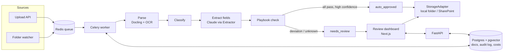

# LexIntake

Automated intake and triage for legal documents at a private equity firm. LexIntake reads incoming
NDAs, side letters, investor notices and legal notices. It works out what each one is, pulls out
the key terms with page-level evidence, and checks them against the legal team's playbook, so
lawyers only review the documents that get flagged.

> Independent portfolio project, not affiliated with any firm. It uses only public and synthetic
> data.

**Status:** Phase 0 (scaffold) is done. The pipeline is built phase by phase. See [PROMPTS.md](PROMPTS.md).

## The problem

A mid-market PE legal team receives thousands of documents a year by email, scanned mail and
SharePoint. Today someone reads every one, decides what it is, checks it against the firm's
standards, files it and tracks it by hand. Most documents are routine. LexIntake does the first
pass and sends only the unusual ones to a lawyer.

## Architecture



Phase 0 builds the boxes that hold everything up: FastAPI, the Celery worker, Redis, Postgres
with pgvector, and the Next.js app, all running together in Docker Compose. The pipeline steps
come in Phases 2–6.

## Tools and libraries, and why

| Tool | Why |
| --- | --- |
| **Python 3.12 + uv** | uv installs packages much faster than pip and writes a lockfile (`uv.lock`), so every machine and CI run gets exactly the same versions. |
| **FastAPI** | Typed request and response models (via Pydantic), automatic OpenAPI docs at `/docs`, and async support for upload endpoints. |
| **Pydantic v2 / pydantic-settings** | Validates data at the edges: settings from env vars now, and later the LLM's JSON output, so bad output is rejected instead of trusted. |
| **Celery + Redis** | Parsing and LLM calls are slow, so they run as background jobs. Redis is the queue. Celery gives retries and acknowledges a job only after it finishes, so a crashed worker doesn't lose it. |
| **Postgres 16 + pgvector** | One database for document metadata, the audit log, cost tracking and (later) embeddings. That means fewer moving parts than a separate vector database. |
| **Next.js + TypeScript + Tailwind** | Server components can call the API over the internal Docker network. TypeScript catches mistakes before runtime, and Tailwind keeps styling quick. |
| **Docker Compose** | One command starts all five services with the same setup on any machine. |
| **ruff, pytest, ESLint** | Fast linting and formatting for Python, tests for the backend, and linting for the frontend. |
| **GitHub Actions** | Runs lint, tests, the lockfile check and a full `docker compose up` smoke test on every push. |

Coming in later phases: Docling (layout-aware PDF parsing + OCR), the Anthropic SDK (classification
and extraction) and Playwright (end-to-end tests for the dashboard).

## File structure

```
lexintake/
├── CLAUDE.md                     # Project brief and working rules for Claude Code
├── PROMPTS.md                    # Phase-by-phase build prompts (Phases 0–9)
├── README.md                     # This file
├── LICENSE                       # MIT license
├── Makefile                      # Shortcuts: make dev / test / lint / requirements / eval
├── docker-compose.yml            # db, redis, api, worker, frontend, with healthchecks
├── requirements.txt              # Pinned backend deps exported from uv.lock (CI checks it is in sync)
├── .env.example                  # Every env var the app reads, placeholder values only
├── .gitignore                    # Keeps .env, data/, .venv/, node_modules/ etc. out of git
├── .github/workflows/ci.yml      # CI: backend, frontend, and Docker Compose smoke test
├── db/init/01_extensions.sql     # Enables pgvector the first time Postgres starts
├── scripts/                      # Data download/generation scripts (Phase 1)
├── playbook/                     # NDA playbook rules (Phase 4)
├── backend/
│   ├── pyproject.toml            # Backend dependencies + ruff and pytest settings
│   ├── uv.lock                   # Exact pinned versions of every dependency
│   ├── .python-version           # Tells uv to use Python 3.12
│   ├── Dockerfile                # Image shared by the api and worker services
│   ├── .dockerignore             # Keeps .venv and tests out of the image
│   ├── app/
│   │   ├── __init__.py           # Marks app/ as a package
│   │   ├── config.py             # Settings read from env vars (DB, Redis, CORS, Anthropic)
│   │   ├── main.py               # FastAPI app, CORS setup, GET /health
│   │   └── worker.py             # Celery app and a `ping` task
│   └── tests/
│       ├── __init__.py           # Marks tests/ as a package
│       ├── test_health.py        # /health returns ok; CORS allows the frontend, blocks others
│       ├── test_config.py        # Env vars parse correctly (CORS list, model name)
│       └── test_worker.py        # Celery ping task runs and is registered
└── frontend/
    ├── package.json              # Frontend deps and scripts (dev, build, lint, typecheck)
    ├── package-lock.json         # Exact pinned npm versions
    ├── next.config.ts            # Standalone output for Docker, Tailwind loader, Cache Components on
    ├── tsconfig.json             # TypeScript settings
    ├── eslint.config.mjs         # ESLint rules (Next.js preset)
    ├── AGENTS.md                 # Notes Next.js writes for coding agents (re-added by `next dev`)
    ├── Dockerfile                # Multi-stage build, runs the standalone server
    ├── .dockerignore             # Keeps node_modules and .next out of the build context
    ├── .gitignore                # Next.js-specific ignores
    └── src/
        ├── app/layout.tsx        # Root HTML layout and fonts
        ├── app/page.tsx          # Status page: server-side and browser-side API health checks
        ├── app/globals.css       # Tailwind import and theme
        ├── app/favicon.ico       # Browser tab icon
        ├── components/StatusRow.tsx      # One row of the health panel
        ├── components/BrowserHealth.tsx  # Client component that calls the API from the browser
        └── lib/api.ts            # The two API URLs (server-side vs browser-side)
```

## Setup

You need [uv](https://docs.astral.sh/uv/), Node 22 and Docker Desktop.

```bash
git clone https://github.com/<your-username>/lexintake.git && cd lexintake
cp .env.example .env          # then fill in ANTHROPIC_API_KEY / ANTHROPIC_MODEL (needed from Phase 3)
make install                  # uv creates backend/.venv with Python 3.12; npm installs the frontend
```

uv downloads Python 3.12 itself if you don't have it, so you don't need conda or pyenv.

## How to run

```bash
make dev
```

- Frontend: http://localhost:3000. Both health rows should say **Healthy**.
- API: http://localhost:8000/health, with interactive docs at http://localhost:8000/docs

If ports 3000/8000 are already in use, set `FRONTEND_PORT` / `API_PORT` in `.env` and update
`NEXT_PUBLIC_API_URL` and `CORS_ORIGINS` to match.

Run the tests and linters:

```bash
make test
make lint
```

Other commands: `make down` (stop the stack), `make requirements` (regenerate `requirements.txt`
after changing dependencies), `make eval` (evaluation harness, Phase 7).

## Evaluation results

Coming in Phase 7.

## How it was built

1. **Phase 0, scaffold.** I set up a uv-managed FastAPI backend with typed settings, CORS and a
   health endpoint, plus a Celery worker on Redis. I added a Next.js frontend that checks the API
   from both the server and the browser, a Docker Compose stack with healthchecks and pgvector,
   a Makefile, and CI that lints, tests, checks the lockfile and boots the whole stack.

## Key concepts

- **Lockfiles and reproducible installs.** `pyproject.toml` says what you want (`fastapi>=0.162`).
  `uv.lock` records exactly what got installed. `uv sync --locked` fails if the two drift apart.
  `requirements.txt` is generated from the lockfile, and CI checks it is in sync.
- **Background jobs with Celery.** The API puts work on a Redis queue and returns immediately, and
  separate worker processes do the slow parts. `task_acks_late` means a job is only marked done
  after it finishes, so a crash leads to a retry instead of a lost document.
- **Docker networking: two URLs for one API.** Inside Docker, containers reach each other by
  service name (`http://api:8000`). The browser runs on your Mac, so it needs `localhost:8000`.
  That's why the frontend has `API_URL_INTERNAL` (server) and `NEXT_PUBLIC_API_URL` (browser).
- **`NEXT_PUBLIC_*` is baked in at build time.** Next.js copies these values into the JS bundle
  during `npm run build`, so changing them needs a rebuild, not just a restart. That's why the
  compose file passes it as a build arg.
- **CORS.** Browsers block a page on `localhost:3000` from reading responses from `localhost:8000`
  unless the API says that origin is allowed. Server-to-server calls don't go through CORS at all.
- **Healthchecks and `depends_on: service_healthy`.** "The container started" is not the same as
  "Postgres accepts connections". Healthchecks make the api and worker wait until db and redis are
  actually ready.
- **Settings from the environment (12-factor).** Code never hardcodes secrets or the model name.
  They come from env vars, with `.env` for local dev and `.env.example` documenting them.

## Known issues

- **httpx deprecation warning in tests.** `pytest` prints a `StarletteDeprecationWarning` from
  FastAPI's `TestClient` saying `httpx` is deprecated there. It's harmless and all tests pass.
  The fix is left for later, until the suggested replacement package has been checked.
- **Port clashes.** If something else on your machine already uses 3000/8000 (or 5432/6379),
  `docker compose up` fails with "port is already allocated". Set the `*_PORT` variables in
  `.env` (see the "How to run" section).

## License

MIT. See [LICENSE](LICENSE).
