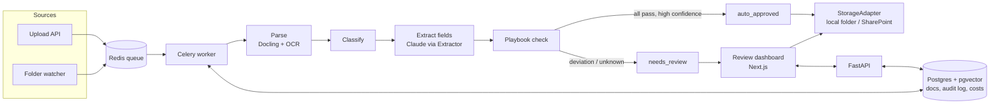

# LexIntake

Automated intake and triage for legal documents at a private equity firm. LexIntake reads incoming
NDAs, side letters, investor notices and legal notices. It works out what each one is, pulls out
the key terms with page-level evidence, and checks them against the legal team's playbook, so
lawyers only review the documents that get flagged.

> Independent portfolio project, not affiliated with any firm. It uses only public and synthetic
> data.

**Status:** Phase 0 (scaffold) and Phase 1 (data) are done. The pipeline is built phase by phase.
See [PROMPTS.md](PROMPTS.md).

## The problem

A mid-market PE legal team receives thousands of documents a year by email, scanned mail and
SharePoint. Today someone reads every one, decides what it is, checks it against the firm's
standards, files it and tracks it by hand. Most documents are routine. LexIntake does the first
pass and sends only the unusual ones to a lawyer.

## Architecture



Phase 0 builds the boxes that hold everything up: FastAPI, the Celery worker, Redis, Postgres
with pgvector, and the Next.js app, all running together in Docker Compose. The pipeline steps
come in Phases 2–6.

## Tools and libraries, and why

| Tool | Why |
| --- | --- |
| **Python 3.12 + uv** | uv installs packages much faster than pip and writes a lockfile (`uv.lock`), so every machine and CI run gets exactly the same versions. |
| **FastAPI** | Typed request and response models (via Pydantic), automatic OpenAPI docs at `/docs`, and async support for upload endpoints. |
| **Pydantic v2 / pydantic-settings** | Validates data at the edges: settings from env vars now, and later the LLM's JSON output, so bad output is rejected instead of trusted. |
| **Celery + Redis** | Parsing and LLM calls are slow, so they run as background jobs. Redis is the queue. Celery gives retries and acknowledges a job only after it finishes, so a crashed worker doesn't lose it. |
| **Postgres 16 + pgvector** | One database for document metadata, the audit log, cost tracking and (later) embeddings. That means fewer moving parts than a separate vector database. |
| **Next.js + TypeScript + Tailwind** | Server components can call the API over the internal Docker network. TypeScript catches mistakes before runtime, and Tailwind keeps styling quick. |
| **Docker Compose** | One command starts all five services with the same setup on any machine. |
| **ruff, pytest, ESLint** | Fast linting and formatting for Python, tests for the backend, and linting for the frontend. |
| **GitHub Actions** | Runs lint, tests, the lockfile check and a full `docker compose up` smoke test on every push. |
| **PyYAML** | The NDA playbook is a YAML file, so lawyers could read and edit the rules without touching code. `safe_load` never runs code from the file. |
| **Faker** | Generates realistic fake names, companies and addresses for synthetic documents. You can seed it, so the same seed gives the same names. |
| **ReportLab** | Builds the synthetic PDFs from text. Its `invariant` mode removes timestamps and random IDs, so the same input gives a byte-identical PDF. |
| **pypdfium2** | Python bindings for PDFium, Chrome's PDF engine. It rasterises pages to make scanned copies, and the tests use it to read the text layer. |
| **Pillow + NumPy** | Pillow rotates and blurs the page images and saves them as an image-only PDF. NumPy adds seeded noise and dust specks. |

Faker, ReportLab, pypdfium2, Pillow and NumPy are only used by the data scripts and tests, so they
sit in uv's `dev` group and stay out of the Docker image.

Coming in later phases: Docling (layout-aware PDF parsing + OCR), the Anthropic SDK (classification
and extraction) and Playwright (end-to-end tests for the dashboard).

## File structure

```
lexintake/
├── CLAUDE.md                     # Project brief and working rules for Claude Code
├── PROMPTS.md                    # Phase-by-phase build prompts (Phases 0–9)
├── README.md                     # This file
├── LICENSE                       # MIT license
├── Makefile                      # Shortcuts: make dev / test / lint / requirements / eval
├── docker-compose.yml            # db, redis, api, worker, frontend, with healthchecks
├── requirements.txt              # Pinned backend deps exported from uv.lock (CI checks it is in sync)
├── .env.example                  # Every env var the app reads, placeholder values only
├── .gitignore                    # Keeps .env, data/, .venv/, node_modules/ etc. out of git
├── .github/workflows/ci.yml      # CI: backend, frontend, and Docker Compose smoke test
├── db/init/01_extensions.sql     # Enables pgvector the first time Postgres starts
├── playbook/
│   └── nda_playbook.yaml         # The legal team's standard NDA terms (max term, allowed law, ...)
├── scripts/
│   ├── __init__.py               # Makes scripts/ importable (tests, python -m)
│   ├── download_data.py          # Downloads ContractNLI (+ CUAD), checks SHA-256, safe to re-run
│   ├── generate_synthetic.py     # CLI: plans the document mix, renders PDFs, writes the manifest
│   └── synth/
│       ├── __init__.py           # Package docstring: how the three modules fit together
│       ├── fields.py             # Samples ground-truth fields per document type
│       ├── templates.py          # Turns fields into document text and records evidence per field
│       └── render.py             # Digital PDFs (ReportLab) and scanned copies (pypdfium2 + Pillow)
├── data/                         # Gitignored. Created by `make data` / `make synthetic`
│   ├── contractnli/              # train/dev/test.json, LICENSE, raw/ original NDAs
│   ├── cuad/                     # Optional (make data-cuad)
│   ├── downloads/                # Verified zip archives, kept so re-runs needn't download again
│   └── synthetic/                # docs/syn_00001.pdf ... and manifest.json
├── backend/
│   ├── pyproject.toml            # Backend dependencies + ruff and pytest settings
│   ├── uv.lock                   # Exact pinned versions of every dependency
│   ├── .python-version           # Tells uv to use Python 3.12
│   ├── Dockerfile                # Image shared by the api and worker services
│   ├── .dockerignore             # Keeps .venv and tests out of the image
│   ├── app/
│   │   ├── __init__.py           # Marks app/ as a package
│   │   ├── config.py             # Settings read from env vars (DB, Redis, CORS, Anthropic)
│   │   ├── main.py               # FastAPI app, CORS setup, GET /health
│   │   ├── playbook.py           # Loads the playbook YAML and evaluates NDA fields against it
│   │   └── worker.py             # Celery app and a `ping` task
│   └── tests/
│       ├── __init__.py           # Marks tests/ as a package
│       ├── test_health.py        # /health returns ok; CORS allows the frontend, blocks others
│       ├── test_config.py        # Env vars parse correctly (CORS list, model name)
│       ├── test_worker.py        # Celery ping task runs and is registered
│       ├── test_playbook.py      # Each playbook rule catches its deviation; null handling
│       ├── test_download_data.py # Checksum check, skip on re-run, zip-slip guard (no network)
│       └── test_synthetic_data.py # Reproducibility, manifest vs files, text layers, evidence
└── frontend/
    ├── package.json              # Frontend deps and scripts (dev, build, lint, typecheck)
    ├── package-lock.json         # Exact pinned npm versions
    ├── next.config.ts            # Standalone output for Docker, Tailwind loader, Cache Components on
    ├── tsconfig.json             # TypeScript settings
    ├── eslint.config.mjs         # ESLint rules (Next.js preset)
    ├── AGENTS.md                 # Notes Next.js writes for coding agents (re-added by `next dev`)
    ├── Dockerfile                # Multi-stage build, runs the standalone server
    ├── .dockerignore             # Keeps node_modules and .next out of the build context
    ├── .gitignore                # Next.js-specific ignores
    └── src/
        ├── app/layout.tsx        # Root HTML layout and fonts
        ├── app/page.tsx          # Status page: server-side and browser-side API health checks
        ├── app/globals.css       # Tailwind import and theme
        ├── app/favicon.ico       # Browser tab icon
        ├── components/StatusRow.tsx      # One row of the health panel
        ├── components/BrowserHealth.tsx  # Client component that calls the API from the browser
        └── lib/api.ts            # The two API URLs (server-side vs browser-side)
```

## Setup

You need [uv](https://docs.astral.sh/uv/), Node 22 and Docker Desktop.

```bash
git clone https://github.com/<your-username>/lexintake.git && cd lexintake
cp .env.example .env          # then fill in ANTHROPIC_API_KEY / ANTHROPIC_MODEL (needed from Phase 3)
make install                  # uv creates backend/.venv with Python 3.12; npm installs the frontend
```

uv downloads Python 3.12 itself if you don't have it, so you don't need conda or pyenv.

## How to run

```bash
make dev
```

- Frontend: http://localhost:3000. Both health rows should say **Healthy**.
- API: http://localhost:8000/health, with interactive docs at http://localhost:8000/docs

If ports 3000/8000 are already in use, set `FRONTEND_PORT` / `API_PORT` in `.env` and update
`NEXT_PUBLIC_API_URL` and `CORS_ORIGINS` to match.

Run the tests and linters:

```bash
make test
make lint
```

Get the data (see [Data](#data) for what each one is):

```bash
make data         # download + verify ContractNLI into data/contractnli (65 MB)
make data-cuad    # optional: also CUAD into data/cuad (106 MB)
make synthetic    # 500 synthetic PDFs + manifest into data/synthetic (about 10 s, 44 MB)
```

Both commands are safe to re-run. `make data` skips datasets that are already there, and `make
synthetic` replaces the previous output. For other options, call the generator directly:

```bash
PYTHONPATH=backend uv run --project backend python -m scripts.generate_synthetic --seed 7 --n 1000
```

Other commands: `make down` (stop the stack), `make requirements` (regenerate `requirements.txt`
after changing dependencies), `make eval` (evaluation harness, Phase 7).

## Data

Nothing in `data/` is committed. The scripts rebuild it, so anyone gets the same data.

### Public datasets

| Dataset | What it is | Source | License |
| --- | --- | --- | --- |
| **ContractNLI** (primary eval set) | 607 real NDAs. Each is labelled against 17 hypotheses ("Receiving party may retain some information", ...) as Entailment / Contradiction / NotMentioned, with evidence spans. | [stanfordnlp.github.io/contract-nli](https://stanfordnlp.github.io/contract-nli/), file `resources/contract-nli.zip` | [CC BY 4.0](https://creativecommons.org/licenses/by/4.0/) (Hitachi America, Ltd.) |
| **CUAD v1** (optional) | 510 commercial contracts with 41 clause types labelled by lawyers. | [Zenodo record 4595826](https://zenodo.org/records/4595826), file `CUAD_v1.zip` | [CC BY 4.0](https://creativecommons.org/licenses/by/4.0/) (The Atticus Project) |

CC BY 4.0 allows use and redistribution as long as you credit the source, which the citations
below do. `download_data.py` pins each archive's SHA-256:

- ContractNLI: `e03fc77b…6287b`
- CUAD: `88b694d9…8d18e` (the file also matches Zenodo's published MD5
  `c38f490a984420b8a62600db401fafd5`)

If the upstream file ever changes, the script stops instead of using it.

```bibtex
@inproceedings{koreeda-manning-2021-contractnli-dataset,
    title = "{C}ontract{NLI}: A Dataset for Document-level Natural Language Inference for Contracts",
    author = "Koreeda, Yuta and Manning, Christopher",
    booktitle = "Findings of the Association for Computational Linguistics: EMNLP 2021",
    year = "2021",
    publisher = "Association for Computational Linguistics",
    url = "https://aclanthology.org/2021.findings-emnlp.164",
    pages = "1907--1919",
}

@article{hendrycks2021cuad,
    title = {CUAD: An Expert-Annotated NLP Dataset for Legal Contract Review},
    author = {Dan Hendrycks and Collin Burns and Anya Chen and Spencer Ball},
    journal = {NeurIPS},
    year = {2021}
}
```

### Synthetic mailroom (`data/synthetic/`)

`scripts/generate_synthetic.py` builds documents from templates. It makes no LLM calls, so it costs
nothing, and the same `--seed` always gives the same documents. The default run (seed 42, 500 docs)
contains:

| Type | Count | Variants |
| --- | --- | --- |
| NDA | 201 | one-way or mutual; term, governing law and optional clauses vary |
| Side letter | 76 | any mix of fee discount, MFN, co-invest and advisory seat |
| Investor notice | 98 | capital call, distribution, annual meeting |
| Legal notice / claim | 50 | demand letter, notice of breach, subpoena |
| Other | 75 | invoice, newsletter, board minutes, marketing flyer |

- **Scanned copies (100, about 20% of every type).** Each page is rasterised at 150 DPI with
  pypdfium2, turned grey, rotated 0.5–2.5°, blurred slightly, given noise and dust specks, and saved
  as an image-only PDF. These files have **no text layer**, so Phase 2 has to OCR them.
- **NDAs vs the playbook.** Half the NDAs meet every rule in
  [`playbook/nda_playbook.yaml`](playbook/nda_playbook.yaml). The other half break one or two rules,
  and every rule gets broken somewhere. The generator picks terms by reading the playbook, and each
  NDA's `deviations` is computed by running the playbook, so the two always agree.
- **Tricky cases.**
  - 5 exact duplicates: byte-identical copies under a new name.
  - 3 near-duplicates: the same NDA with exactly one clause changed.
  - 3 NDAs with unusual titles, such as "Evaluation Material Letter Agreement".
- **Neutral file names** (`syn_00001.pdf`), so the file name gives away nothing about the type.
- All names are fictional and come from Faker plus made-up fund families. Any resemblance to a
  real firm is coincidental.

### The manifest (`data/synthetic/manifest.json`)

This is the ground truth that Phase 7 grades against. It has one entry per file (abridged example):

```json
{
  "doc_id": "syn_00001", "file": "docs/syn_00001.pdf", "sha256": "e8ae42…",
  "doc_type": "nda", "subtype": null, "title": "Mutual Confidentiality Agreement",
  "scanned": true, "scan_rotation_deg": 2.45, "pages": 2,
  "fields": {
    "counterparty": "Pearson Aerospace LLC", "fund_party": "Ostrander Hill Capital Fund IV, L.P.",
    "effective_date": "2025-01-16", "mutual": true, "term_months": 6,
    "governing_law": "Cayman Islands", "non_solicit_months": 9, "non_compete_months": null,
    "residuals_clause": null, "return_destroy_days": 30
  },
  "evidence": {
    "governing_law": "This Agreement shall be governed by and construed in accordance with the laws of the Cayman Islands, without regard to its conflict of laws principles.",
    "...": "..."
  },
  "deviations": ["governing_law_allowed"],
  "tricky": null, "duplicate_of": null, "near_duplicate_of": null, "changed_field": null
}
```

**What `null` means:**

- **In `fields`, `null` means the clause is absent from the document.** `"non_compete_months":
  null` means the NDA has no non-compete. It never means "unknown", and it isn't written as `0` or
  `false`.
- A clause with a number stores that number when present (`non_solicit_months: 9`,
  `return_destroy_days: 30`). A clause with no number (`residuals_clause`, and the side-letter
  clauses `mfn`, `co_investment` and `advisory_committee_seat`) is `true` when present and `null`
  when absent. Clauses never use `false`.
- Core fields are never null. For NDAs those are `counterparty`, `fund_party`, `effective_date`,
  `mutual`, `term_months` and `governing_law`. `mutual` is a real true/false value, because it
  describes the structure of the NDA rather than a clause.
- A field that doesn't apply to a document type is left out of `fields`, not set to null. For
  example, an invoice has no `governing_law` key.
- At the top level of an entry, `deviations` is `null` for non-NDAs, because the playbook doesn't
  apply to them. `duplicate_of`, `near_duplicate_of` and `changed_field` are `null` unless the
  document is that kind of tricky case.

**Evidence** is the exact text in the document that states each field. Every non-null field has
one, and absent clauses have none. For digital PDFs the tests check that every evidence string
appears verbatim in the extracted text, after collapsing whitespace, because a wrapped line comes
out with a newline where the space was. **Scanned PDFs need fuzzy matching in Phase 7.** Their text
only exists after OCR, and OCR makes small mistakes ("l" for "1", dropped punctuation, merged
words). So exact substring matching would mark correct answers as wrong. Phase 7 should use a
normalised edit-distance or token-overlap threshold for scanned documents instead.

**Reproducibility.** The same seed with the same locked dependencies on the same OS gives
byte-identical PDFs and manifest. That's why the manifest can store each file's SHA-256. On a
different OS the fields, text and evidence stay identical, but scanned-PDF bytes, and so their
hashes, can differ slightly, because image rendering and JPEG compression vary by platform.

## Evaluation results

Coming in Phase 7.

## How it was built

1. **Phase 0, scaffold.** I set up a uv-managed FastAPI backend with typed settings, CORS and a
   health endpoint, plus a Celery worker on Redis. I added a Next.js frontend that checks the API
   from both the server and the browser, a Docker Compose stack with healthchecks and pgvector,
   a Makefile, and CI that lints, tests, checks the lockfile and boots the whole stack.
2. **Phase 1, data.** I found the official sources for ContractNLI and CUAD and checked their
   licenses (both CC BY 4.0). Then I wrote a standard-library download script that verifies a pinned
   SHA-256, extracts safely and skips finished datasets. Next I wrote the NDA playbook as YAML, with
   a small evaluator in the backend, so "standard terms" are defined in one place. On top of that I
   built a seeded template-based generator: it samples fields (NDA terms chosen against the
   playbook), writes text that records the evidence for each field, renders reproducible PDFs, and
   makes scanned copies with no text layer. It adds duplicates, near-duplicates and unusual titles,
   and writes a manifest. Tests check that the manifest matches the files and that every evidence
   string really appears in the PDF.

## Key concepts

- **Lockfiles and reproducible installs.** `pyproject.toml` says what you want (`fastapi>=0.162`).
  `uv.lock` records exactly what got installed. `uv sync --locked` fails if the two drift apart.
  `requirements.txt` is generated from the lockfile, and CI checks it is in sync.
- **Background jobs with Celery.** The API puts work on a Redis queue and returns immediately, and
  separate worker processes do the slow parts. `task_acks_late` means a job is only marked done
  after it finishes, so a crash leads to a retry instead of a lost document.
- **Docker networking: two URLs for one API.** Inside Docker, containers reach each other by
  service name (`http://api:8000`). The browser runs on your Mac, so it needs `localhost:8000`.
  That's why the frontend has `API_URL_INTERNAL` (server) and `NEXT_PUBLIC_API_URL` (browser).
- **`NEXT_PUBLIC_*` is baked in at build time.** Next.js copies these values into the JS bundle
  during `npm run build`, so changing them needs a rebuild, not just a restart. That's why the
  compose file passes it as a build arg.
- **CORS.** Browsers block a page on `localhost:3000` from reading responses from `localhost:8000`
  unless the API says that origin is allowed. Server-to-server calls don't go through CORS at all.
- **Healthchecks and `depends_on: service_healthy`.** "The container started" is not the same as
  "Postgres accepts connections". Healthchecks make the api and worker wait until db and redis are
  actually ready.
- **Settings from the environment (12-factor).** Code never hardcodes secrets or the model name.
  They come from env vars, with `.env` for local dev and `.env.example` documenting them.
- **Checksums.** A SHA-256 hash is a fingerprint of a file's bytes. If even one byte changes, the
  hash changes. Pinning the expected hash means a corrupted, truncated or swapped download is
  caught before it's used. The same idea powers deduplication in Phase 2: identical files have
  identical hashes.
- **Idempotent scripts.** Running a script twice should leave things as if it ran once. The
  download script writes a `.complete` marker only after everything has finished, and it extracts
  into a staging folder that it renames at the end. So an interrupted run is simply redone, and a
  finished one is skipped.
- **Zip slip.** A malicious zip can contain a path like `../../.bashrc` that writes outside the
  target folder. The extractor resolves each path and refuses any that escape.
- **Seeded randomness and reproducibility.** Computers make "random" numbers from a seed, so the
  same seed gives the same sequence. Everything random in the generator comes from seeded sources.
  Dates come from a fixed range rather than from "today", and the PDFs have no timestamps. As a
  result, the same seed gives byte-identical output, which the tests check.
- **Text layer vs scanned PDF.** A digital PDF stores the characters, so you can select and copy
  the text. A scanned PDF only stores a picture of the page, so getting text out of it needs OCR,
  which is slower and makes mistakes. A real mailroom has both, so the pipeline has to handle both.
- **Ground truth and evidence.** You can only measure accuracy against known correct answers. The
  manifest is built from the same field values that produce the document text, so it is correct by
  construction. The recorded evidence also lets Phase 7 check *where* the model found an answer,
  not just whether the value is right.
- **Single source of truth.** The playbook YAML defines "standard terms" once. The generator uses
  it to label the data, and Phase 4's checker will use it to flag real documents, so the labels and
  the checker can't drift apart.
- **Explicit null semantics.** "Clause absent", "unknown" and "not applicable" are different
  things. The manifest uses `null` only for "absent" and leaves out fields that don't apply.
  Phase 3's "the model isn't sure" will be a separate confidence score, so grading never has to
  guess what a value means.

## Known issues

- **httpx deprecation warning in tests.** `pytest` prints a `StarletteDeprecationWarning` from
  FastAPI's `TestClient` saying `httpx` is deprecated there. It's harmless and all tests pass.
  The fix is left for later, until the suggested replacement package has been checked.
- **Port clashes.** If something else on your machine already uses 3000/8000 (or 5432/6379),
  `docker compose up` fails with "port is already allocated". Set the `*_PORT` variables in
  `.env` (see the "How to run" section).
- **ContractNLI is text, not PDFs (next step for Phase 7).** The labels and evidence spans in
  `train/dev/test.json` are character offsets into each NDA's plain `text`. The zip also ships
  originals in `raw/` (363 PDFs plus text/HTML files), but their layout doesn't match those
  offsets. So Phase 7 will need to either render the JSON text to PDF, reusing
  `scripts/synth/render.py` so the offsets still line up, or let the pipeline accept text input
  directly. This isn't built yet.
- **Playbook path inside Docker.** `backend/app/playbook.py` looks for `playbook/` at the repo
  root, which isn't copied into the backend image. Phase 4 will mount or copy it when the worker
  starts using the playbook.

## License

MIT. See [LICENSE](LICENSE).
